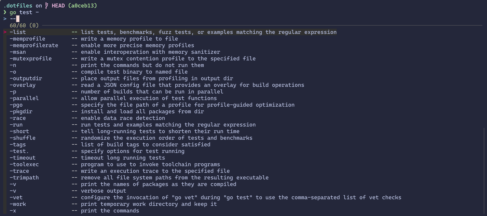
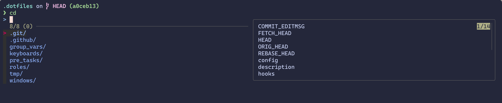
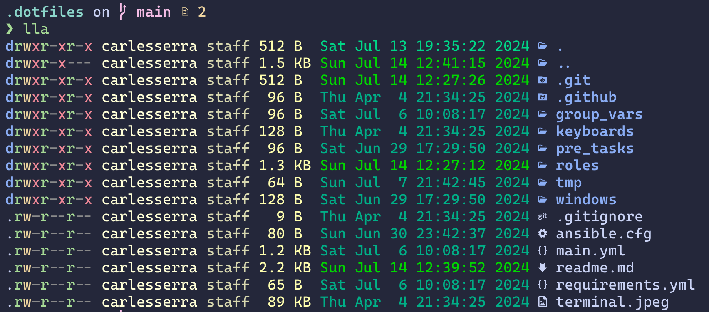

<h2 style="
    text-align: center;
    font-weight:200;
    font-size: 18px;
">.dotfiles</h2>
<p align="center">
    
    
    
</p>

## Dev

Install shellcheck

```sh
brew install shellcheck
```

Install shfmt

```sh
brew install shfmt
```

### Add new script

Add a new file to the `runs` directory.

Then make the file executable.

```sh
chmod u+x runs/vscode
```

## Install

### Macos setup

Install brew package manager. [Brew documentation](https://brew.sh)

```shell
/bin/bash -c "$(curl -fsSL https://raw.githubusercontent.com/Homebrew/install/HEAD/install.sh)"
```

Export path of brew to be able to use brew binary

```shell
export PATH="/opt/homebrew/bin:$PATH"
```

### Ubuntu setup

Update and install basic packages for using apt.

```shell
sudo apt update
sudo apt install software-properties-common
```

### Launch install scripts

The following commands requires to be run from .dotfiles root directory from the repository ~/.dotfiles

```shell
./run
```

Using the first argument you can launch only specific scripts. This is really useful to update changed configuration without running all the scripts, because we are not using symlinks to be idempotent. To update changes, we need to launch again the scripts.

```shell
./run vscode
```

## Documentation

### Agent skills

Install skills for GitHub Copilot and Claude Code:

```shell
./run skills
```

Node.js and npm must be available so the command can use `npx skills`.
The command installs globally without confirmation prompts:

- All skills from [mattpocock/skills](https://github.com/mattpocock/skills).
- `asd-ste100` from [danyuchn/asd-ste100-skill](https://github.com/danyuchn/asd-ste100-skill).
- Personal `pr-review`, `show-me` and `training-coach` skills from [runs/skills/personal/](runs/skills/personal/).

The `training-coach` skill coaches trail running, climbing, alpinism and gym strength. It bundles a Zepp Life CLI (`scripts/zepp`) that needs [uv](https://docs.astral.sh/uv/). It keeps no personal data. The plans live in the Obsidian vault at `~/notes/notes/coach/`. Each plan is independent and holds its own full snapshot of the athlete profile, and plans never link to each other. Each routine repeats the part of the profile that affects it. If that folder does not exist, the skill asks for the path. See `references/zepp.md` in the skill for the Zepp setup.

Only personal skills are stored here. Upstream skills are downloaded during installation.
Edit personal skills here and rerun `./run skills` to install updates.
The CLI manages skill installation and agent links. Existing skills with the same names can be replaced.
The command does not copy or change agent instructions, preferences, permissions, or VS Code configuration.
Like other executable scripts under `runs/`, it also runs with `./run`.

Documentation for things that are not automated.

- [Windows dotfiles](./doc/windows/readme.md)
- [Nuphy Keyboard](./doc/keyboards/nuphy-air60v2/readme.md)
- [Planck Keyboard](./doc/keyboards/planck/readme.md)

### Roadmap

- Automate setup keyboard shortcut for changing window focus instead of manually changing from Settings > Keyboard > Shortcuts > (Keyboard) Move focus to next window opt + x
- When laptop is connected to a monitor, automatically change the display settings to mirror the display instead of extending it. If the monitor brightness is removed, it mimics disconnecting the laptop display when connected to a monitor. maybe create an script. Settings > Display > Built-in Display > Mirror display
- Regression test from zero
- Capture control + c to exit the run script
- capture exit 1 from run script
- Setup docker to test clean installs (Linux and macos)
- Automate sudo, ask at the beginning of the script only.
- Prettify logs and error handling (Better show when script errors, maybe finish script execution?)

### Resources

- https://github.com/Gentleman-Programming/Gentleman.Dots
- https://github.com/ThePrimeagen/dev
- https://github.com/ThePrimeagen/.dotfiles
- https://github.com/typecraft-dev/dotfiles
- https://github.com/joshmedeski/dotfiles
