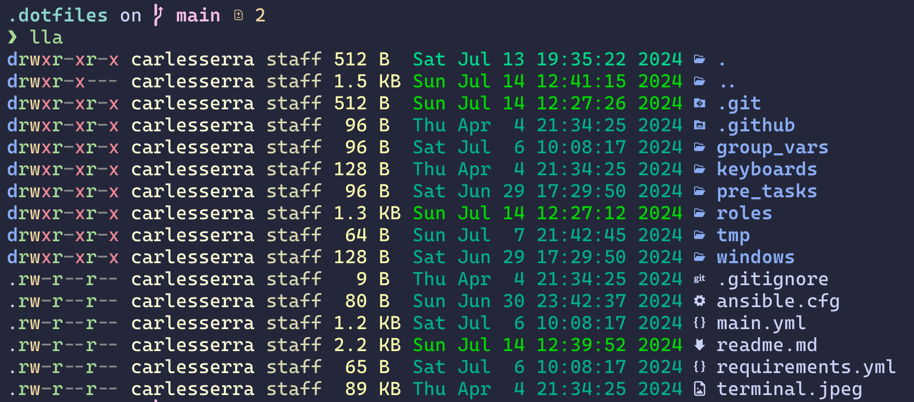
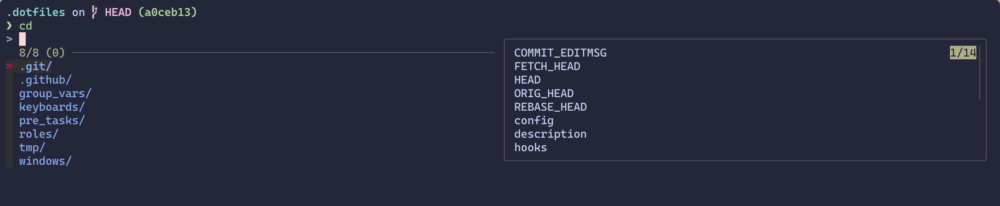

# .dotfiles

A personal workstation setup for macOS and Ubuntu-style Linux. It includes shell tools, application installers, copied configuration, and agent skills.

  
  

## Documentation

- [User guides and references](https://carseven.github.io/.dotfiles/)
- [Browse the documentation source](./site/src/content/docs/index.md)
- [Safe setup guide](./site/src/content/docs/guides/setup.md)
- [Development, tests, and Docker runner](./docs/development.md)
- [Windows setup](./site/src/content/docs/guides/windows.md)
- [NuPhy Air60 V2 setup](./site/src/content/docs/guides/nuphy-air60-v2.md)
- [Planck keyboard setup](./site/src/content/docs/guides/planck-keyboard.md)
- [Maintainer documentation](./docs/readme.md)

Review installers before running them. `./run --dry TARGET` lists selected scripts; it does not simulate their effects. Installers may use `sudo`, download executable code, and change machine settings.
