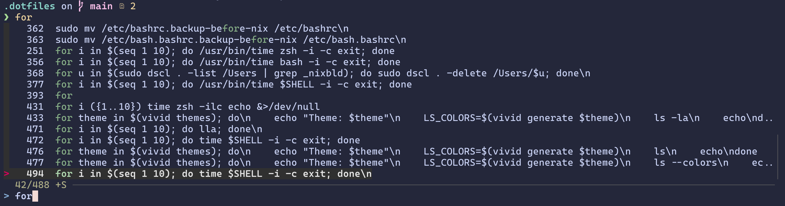

# .dotfiles

A personal workstation setup for macOS and Ubuntu-style Linux. It includes shell tools, application installers, copied configuration, and agent skills.

For more information, see the [documentation](https://carseven.github.io/.dotfiles/).

  
  

