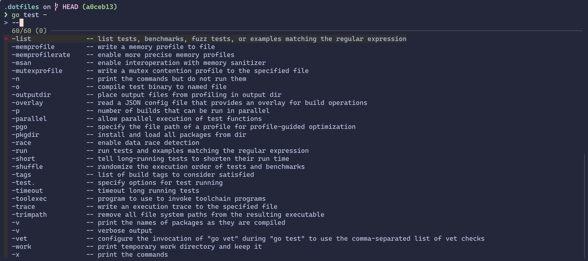

<h2 style="
    text-align: center;
    font-weight:200;
    font-size: 18px;
">.dotfiles</h2>
<p align="center">
    
    
    
</p>

## Dev

Install shellcheck

```sh
brew install shellcheck
```

Install shfmt

```sh
brew install shfmt
```

### Shell tests

Run the shared shell-test suite with Python 3 (no extra packages required):

```shell
./test
```

The runner works from any directory when invoked by its path, such as `~/.dotfiles/test`.
It discovers `shell/tests/test_*.py` and returns a nonzero status when tests fail.
CI runs the same command on Linux and macOS. ShellCheck and shfmt remain separate lint checks.

Currently, only `gh-approved` has behavior tests.
They run the real Bash script with mocked `gh` and `fzf` commands.
They cover URL validation, batch approvals, assigned PR selection, host overrides, cancellation, and errors.

To test another script:

1. Add `shell/tests/test_<script_name>.py` using Python's standard `unittest` library.
2. Run the script as a subprocess with a timeout. Check its output, exit status, and command calls.
3. Use temporary directories and an explicit environment. Do not inherit credentials or real executable paths.
4. Mock commands that access remote services, change system settings, or install software.
5. Run `./test`. No CI changes are needed for additional test files.

Keep script-specific mocks in their test files until another test needs a shared helper.
Tests must not access GitHub, use real credentials, submit approvals, or change the machine outside temporary directories.

### Add new script

Add a new file to the `runs` directory.

Then make the file executable.

```sh
chmod u+x runs/vscode
```

## Install

### Macos setup

Install brew package manager. [Brew documentation](https://brew.sh)

```shell
/bin/bash -c "$(curl -fsSL https://raw.githubusercontent.com/Homebrew/install/HEAD/install.sh)"
```

Export path of brew to be able to use brew binary

```shell
export PATH="/opt/homebrew/bin:$PATH"
```

### Ubuntu setup

Update and install basic packages for using apt.

```shell
sudo apt update
sudo apt install software-properties-common
```

### Launch install scripts

The following commands requires to be run from .dotfiles root directory from the repository ~/.dotfiles

```shell
./run
```

Using the first argument you can launch only specific scripts. This is really useful to update changed configuration without running all the scripts, because we are not using symlinks to be idempotent. To update changes, we need to launch again the scripts.

```shell
./run vscode
```

## Documentation

### Zsh completion

In the fzf-tab completion menu, use the arrow keys to navigate.
Press Tab to select or deselect each result.
Press Enter to insert the selected results. Ctrl+Space is disabled in this menu.

### Approve a pull request

Use `gh-approved` with one or more GitHub or GitHub Enterprise pull request URLs.
It submits approvals using GitHub CLI (`gh`).
Authenticate once for each host:

```shell
gh auth login --hostname github.azc.ext.hp.com
```

The shell setup (`./run zsh`) installs the command. To install or update only this command:

```shell
chmod u+x shell/scripts/gh-approved
mkdir -p "$HOME/.local/bin"
cp shell/scripts/gh-approved "$HOME/.local/bin/gh-approved"
```

The shell configuration already adds `~/.local/bin` to `PATH`.

```shell
gh-approved https://github.azc.ext.hp.com/bcn-robotics/aec_mfe_projects_react/pull/377

gh-approved https://github.com/owner/repo/pull/1 https://github.com/owner/repo/pull/2
```

Without URLs, the command uses `fzf` to select open pull requests assigned to you:

```shell
gh-approved

# Override the default search host (github.azc.ext.hp.com).
GH_HOST=github.com gh-approved
```

Install `fzf` for interactive selection. Press Tab to select multiple PRs, then Enter to approve.
Press Esc or Ctrl-C to cancel without approving anything.
The picker fetches up to 1000 PRs, with the most recently updated first.
It filters by assignee, not by requested reviewer.

Each explicit URL determines its own host, regardless of the search host.
The command validates all URLs before approving any PR.
Authentication and approval errors from `gh` remain visible.
If an approval fails, the command continues with the remaining PRs and exits with the first failure status.
### Agent skills

Install skills for GitHub Copilot and Claude Code:

```shell
./run skills
```

Node.js and npm must be available so the command can use `npx skills`.
The command installs globally without confirmation prompts:

- All skills from [mattpocock/skills](https://github.com/mattpocock/skills).
- `asd-ste100` from [danyuchn/asd-ste100-skill](https://github.com/danyuchn/asd-ste100-skill).
- Personal `pr-review`, `show-me` and `training-coach` skills from [runs/skills/personal/](runs/skills/personal/).

The `training-coach` skill coaches trail running, climbing, alpinism and gym strength. It has two modes: create a plan from scratch, and sync real data to update a plan and propose "no changes" or modifications. If you give no mode, it asks you to create a plan or pick one of your existing plans to sync. It bundles a Zepp Life CLI (`scripts/zepp`) that needs [uv](https://docs.astral.sh/uv/). It keeps no personal data. The plans live in the Obsidian vault at `~/notes/notes/coach/`. Each plan is independent and holds its own full snapshot of the athlete profile, and plans never link to each other. Each routine repeats the part of the profile that affects it. If that folder does not exist, the skill asks for the path. See `references/zepp.md` in the skill for the Zepp setup.

Only personal skills are stored here. Upstream skills are downloaded during installation.
Edit personal skills here and rerun `./run skills` to install updates.
The CLI manages skill installation and agent links. Existing skills with the same names can be replaced.
The command does not copy or change agent instructions, preferences, permissions, or VS Code configuration.
Like other executable scripts under `runs/`, it also runs with `./run`.

Documentation for things that are not automated.

- [Windows dotfiles](./doc/windows/readme.md)
- [Nuphy Keyboard](./doc/keyboards/nuphy-air60v2/readme.md)
- [Planck Keyboard](./doc/keyboards/planck/readme.md)

### Roadmap

- Automate setup keyboard shortcut for changing window focus instead of manually changing from Settings > Keyboard > Shortcuts > (Keyboard) Move focus to next window opt + x
- When laptop is connected to a monitor, automatically change the display settings to mirror the display instead of extending it. If the monitor brightness is removed, it mimics disconnecting the laptop display when connected to a monitor. maybe create an script. Settings > Display > Built-in Display > Mirror display
- Regression test from zero
- Capture control + c to exit the run script
- capture exit 1 from run script
- Setup docker to test clean installs (Linux and macos)
- Automate sudo, ask at the beginning of the script only.
- Prettify logs and error handling (Better show when script errors, maybe finish script execution?)

### Resources

- https://github.com/Gentleman-Programming/Gentleman.Dots
- https://github.com/ThePrimeagen/dev
- https://github.com/ThePrimeagen/.dotfiles
- https://github.com/typecraft-dev/dotfiles
- https://github.com/joshmedeski/dotfiles
