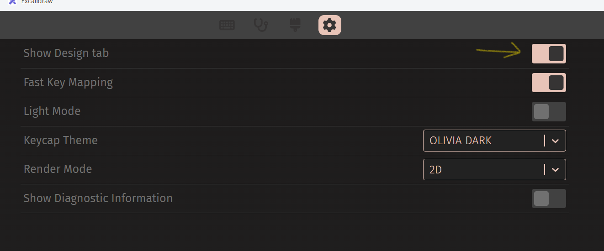
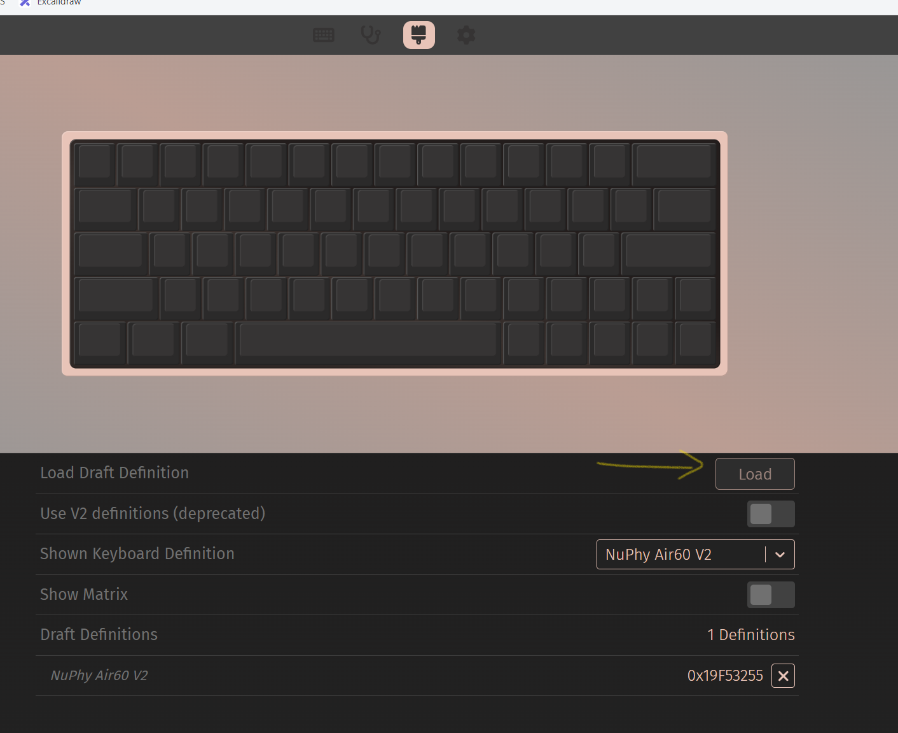
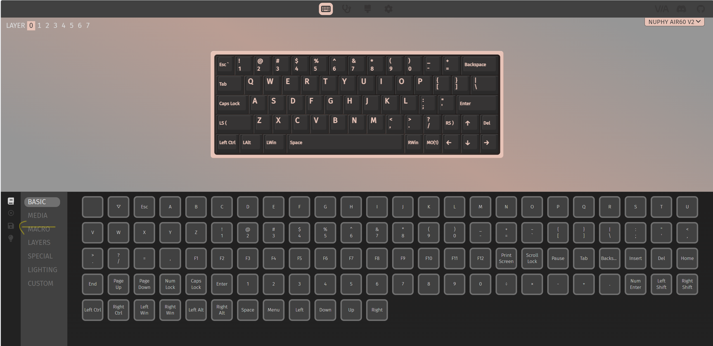
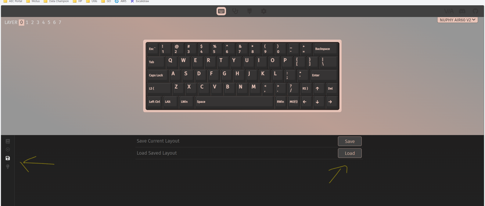
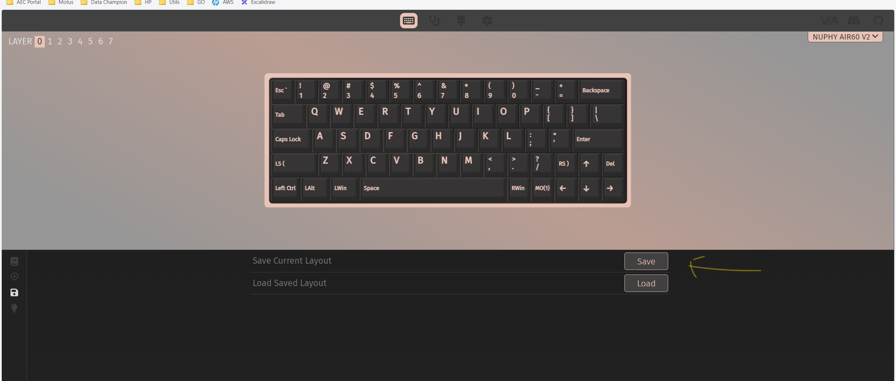

This guide loads the NuPhy Air60 V2 VIA definition and keymap stored in this repository.
Use a supported browser and connect the keyboard before opening VIA.

## Load the VIA definition

1. Open [VIA](https://usevia.app/).
2. Connect the NuPhy Air60 V2.
3. Open **Settings** and enable **Show Design tab**.

   

4. Open the **Design** tab and load [`nuphy-air60-v2-via.json`](https://github.com/carseven/.dotfiles/blob/main/doc/keyboards/nuphy-air60v2/nuphy-air60-v2-via.json).

   

## Load the custom keymap

1. Open the **Configure** tab.
2. Load [`nuphy_air60_v2.layout.json`](https://github.com/carseven/.dotfiles/blob/main/doc/keyboards/nuphy-air60v2/nuphy_air60_v2.layout.json) as the keyboard layout.

   

   

3. Review the keys in VIA before using the keyboard. Loading a layout changes the keyboard mapping.
4. If you change the layout, save the updated JSON file in your fork so you can restore it later.

   
