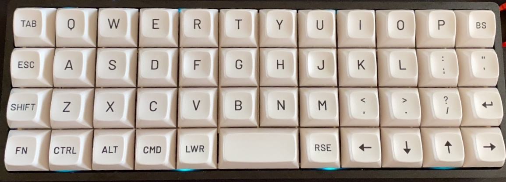

This repository contains a custom QMK keymap for the Planck rev6.
The keymap includes personal layers and mappings. Review the source before compiling or flashing it.



## Install QMK

On macOS, install the QMK CLI:

```bash
brew install qmk/qmk/qmk
```

For other operating systems, follow the official [QMK setup guide](https://docs.qmk.fm/newbs_getting_started).
Complete QMK setup before copying the keymap.

## Copy the keymap

From the root of this repository, create the keymap directory in your QMK firmware checkout and copy the required files:

```bash
mkdir -p ~/qmk_firmware/keyboards/planck/keymaps/carseven
cp doc/keyboards/planck/keymap.c ~/qmk_firmware/keyboards/planck/keymaps/carseven/
cp doc/keyboards/planck/keymap_spanish.h ~/qmk_firmware/keyboards/planck/keymaps/carseven/
cp doc/keyboards/planck/config.h ~/qmk_firmware/keyboards/planck/keymaps/carseven/
cp doc/keyboards/planck/rules.mk ~/qmk_firmware/keyboards/planck/keymaps/carseven/
cp doc/keyboards/planck/audio_songs.h ~/qmk_firmware/keyboards/planck/keymaps/carseven/
```

The keymap uses audio and mouse-key features. Check that the selected Planck revision supports them before building.

## Compile and flash

Compile the Planck rev6 keymap:

```bash
qmk compile -kb planck/rev6 -km carseven
```

Connect the keyboard in bootloader mode, then flash it:

```bash
qmk flash -kb planck/rev6 -km carseven
```

Flashing changes the keyboard firmware. Confirm that the board and revision are correct before you proceed.
